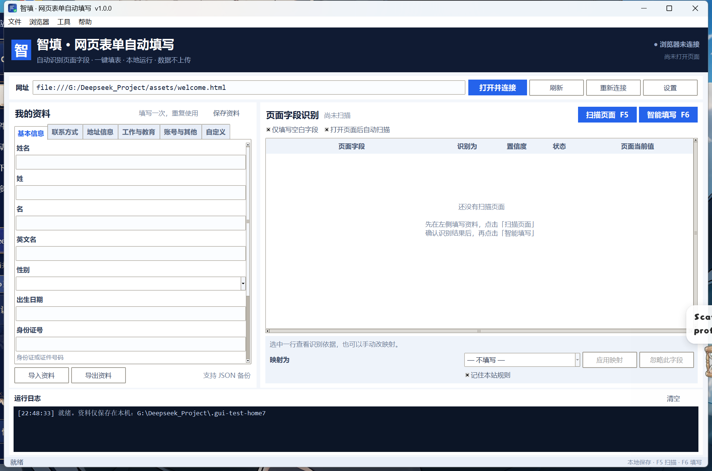

# 智填 · 网页表单自动填写

一个完全本地运行的 Windows 桌面工具：打开网页后自动识别输入框、下拉框、单选框、复选框，按你的个人资料一键填写。所有资料保存在本机，不上传服务器。



## 主要能力

- **自动识别**：综合字段标签、`placeholder`、`name`/`id`、`aria-label`、`autocomplete`、控件类型和周围文字打分。
- **一键填写**：支持文本框、文本域、下拉框、单选组、复选框、日期框和 `contenteditable` 区域。
- **框架兼容**：用原生 setter + `input`/`change` 事件写入，React、Vue、Angular 等受控表单可以正常更新。
- **跨框架**：可扫描同源与跨域 iframe，也支持开放的 Shadow DOM。
- **人工校正**：识别结果带置信度和依据；识别错了可以手动改映射，并记住当前网站的规则。
- **资料管理**：内置常见中文/英文表单字段，支持任意自定义字段，支持 JSON 导入导出。
- **本地浏览器**：使用一个独立的 Edge/Chrome 配置目录，登录状态可保留，不与日常浏览器配置混用。
- **不覆盖内容**：默认只填写空白字段；可在设置中关闭。

## 交付文件

| 文件 | 说明 |
| --- | --- |
| `dist\SmartFormFiller.exe` | 单文件版，约 10 MB，双击即用；会在当前目录临时解压运行文件 |
| `dist\SmartFormFillerPortable\SmartFormFillerPortable.exe` | 便携文件夹版，启动更快，不依赖系统临时目录 |
| `dist\SmartFormFillerPortable.zip` | 便携版压缩包，解压后运行 |

如果单文件版在受管电脑上提示“无法创建临时目录”，请改用便携版。

## 快速开始

1. 双击 `SmartFormFiller.exe`（或便携版 `SmartFormFillerPortable.exe`）。
2. 在左侧填写常用资料，至少填姓名、手机号、邮箱等；点击“保存资料”。
3. 在顶部网址栏输入目标网页，点击“打开并连接”。
4. 点击“扫描页面”（F5）。程序会在右侧列出页面字段、识别结果和置信度。
5. 检查“识别为”列；如有错误，选中该行，在下方“映射为”中重新选择，点击“应用映射”。勾选“记住本站规则”后，下次会自动沿用。
6. 点击“智能填写”（F6）。填写成功的字段会变成绿色，并在页面上短暂高亮。

第一次使用可以先点菜单“工具 → 导入示例页面”，在自带示例表单上试一遍。

## 识别与填写说明

### 识别优先级

程序对每个字段收集多路文本证据，按权重打分：

| 证据 | 说明 |
| --- | --- |
| 标签文字 | `<label>`、`aria-labelledby`、表格前单元格、`fieldset` 标题 |
| 无障碍标签 | `aria-label` |
| 占位提示 | `placeholder` |
| 属性 | `name`、`id`、`title` |
| 控件类型 | `email`、`tel`、`date`、`password`、复选框、单选组 |
| 浏览器提示 | `autocomplete` |
| 周围文字 | 父容器文本（低权重） |

有把握才自动映射；置信度低或存在相近字段时会标出 `?`，建议人工确认。

### 手动规则

手动映射或忽略后，规则按“站点 + 字段签名”保存。字段签名优先使用 `name`，其次 `id`、`autocomplete`、标签、占位提示。网站改版后旧规则可能失效，重新扫描并调整即可。

### 支持范围

- 普通 HTML 表单、Ant Design / Element UI / iView 等常见组件库的输入框。
- 原生 `select`、单选框组、复选框、日期输入。
- 部分自定义下拉组件：会尝试输入并点击匹配的下拉项。
- iframe：通过 DevTools 协议在每个 frame 中执行，跨域也可尝试；被浏览器策略或登录限制的 frame 可能无法访问。
- Shadow DOM：会递归进入开放的 shadow root。

### 暂不支持

- 文件上传、图片验证码、滑块验证、短信验证码。
- Canvas 绘制或高度定制的日期/级联组件（能识别但可能需要手动操作）。
- PDF 表单、桌面客户端表单。
- 多步骤表单的自动翻页（每一步仍可扫描/填写）。

## 数据与隐私

- 数据目录按以下顺序自动选择，运行日志与“关于”窗口会显示实际路径：
  1. `%APPDATA%\SmartFormFiller`
  2. `%LOCALAPPDATA%\SmartFormFiller`
  3. 程序所在目录的 `SmartFormFiller-Data`
  4. 系统临时目录的 `SmartFormFiller`
- 某些受管电脑会拒绝程序写入 `%APPDATA%`。从 1.0.1 开始，程序会自动切换到下一个可写目录，不再因此闪退。
- 数据目录内包含：
  - `profile.json`：资料内容
  - `settings.json`：设置
  - `rules.json`：各网站字段规则
  - `browser-profile\`：独立浏览器配置（Cookie、登录状态）
- 所有处理都在本机完成，程序不发送任何资料到网络。
- 资料文件是明文 JSON。不要在公共电脑上保存身份证号、密码等敏感信息；密码字段是可选的，默认留空。
- 导出的 JSON 备份同样包含明文资料，请妥善保管。

## 常见问题

**双击后没有窗口 / 程序闪退**

- 从 1.0.1 开始，启动失败会弹出错误对话框，并在程序目录或临时目录写入 `startup-error.log`。
- 请确认解压完整：便携版的 `SmartFormFillerPortable.exe` 旁边必须有 `_internal` 文件夹。不要直接在压缩包里双击 EXE，也不要把 EXE 单独复制出来。
- 请把程序解压到“下载”“桌面”等可写目录，不要放在 `C:\Program Files` 等受保护目录。
- 如果日志里是 `PermissionError ... AppData`，说明系统禁止写入用户配置目录；1.0.1 会自动改用程序目录下的 `SmartFormFiller-Data`。仍失败时，把整个程序文件夹移到可写目录再试。
- 如果弹出 Windows SmartScreen，请点“更多信息 → 仍要运行”。

**浏览器启动失败 / 打开后没有反应**

- 程序会自动尝试 Edge、Chrome；请确保已安装其中之一。
- 某些安全软件会拦截带调试端口的浏览器启动。可先手动打开 Edge/Chrome，再在设置中选择对应浏览器重试。
- 程序会在正常的浏览器沙箱失败时自动使用兼容模式；兼容模式会关闭 Chromium 渲染器沙箱，仅建议在受信任的网站使用。

**扫描不到字段**

- 先确认页面已经加载完成，再点“扫描页面”。
- 表单可能在新标签页或弹窗中：菜单“浏览器 → 选择标签页”切换后重新扫描。
- 表单可能在受限的跨域 iframe 中，或页面用了 Canvas/自定义控件。
- 可以添加自定义字段，或在识别结果中手动映射。

**填进去但页面不认**

- 少数组件需要失焦或额外事件；本程序会触发 `input`、`change`、`blur`，但个别组件仍可能不兼容。
- 检查字段格式：日期、手机号、身份证号等可能需要特定格式。
- 可尝试关闭“仅填写空白字段”后重新填写，或手动修改页面。

**首次运行被 Windows SmartScreen 拦截**

本程序未做代码签名，Windows 可能提示“未知发布者”。点击“更多信息 → 仍要运行”即可。若企业环境禁止运行未签名程序，需要使用签名证书重新打包。

**提示 Could not create temporary directory / 无法创建临时目录**

单文件 EXE 启动时会在“当前目录”临时解压运行文件。如果从 `C:\Program Files` 等只读目录启动，仍可能失败；优先改用便携文件夹版，或把单文件版放到“下载/桌面”再运行。也可以先把 `TEMP` 和 `TMP` 指向一个可写目录再运行：

```powershell
$env:TEMP = "D:\Temp"
$env:TMP  = "D:\Temp"
.\SmartFormFiller.exe
```

## 从源码构建

要求：Windows 10/11、Python 3.10+、可用的 Edge 或 Chrome。

```powershell
python -m venv .venv
.\.venv\Scripts\python.exe -m pip install pyinstaller websocket-client pillow
.\build.ps1
```

输出：

- `dist\SmartFormFiller.exe`：单文件版，约 10 MB
- `dist\SmartFormFillerPortable\`：便携文件夹版，约 22 MB
- `dist\SmartFormFillerPortable.zip`：便携版压缩包

也可以直接以源码运行：

```powershell
.\.venv\Scripts\python.exe app.py
```

### 自检

```powershell
.\.venv\Scripts\python.exe app.py --selftest .\selftest-result.json
```

打包后的程序也可执行：

```powershell
.\dist\SmartFormFiller.exe --selftest .\selftest-result.json
```

自检会启动无头 Edge，在自带示例页面上扫描并填写 20 个字段，结果写入 JSON。

## 项目结构

```text
app.py                    程序入口、自检模式
formfiller/
  fields.py               字段目录、别名、值转换
  matcher.py              字段打分与匹配
  storage.py              资料/设置/规则持久化
  cdp.py                  Chrome DevTools Protocol 客户端与浏览器启动
  page_js.py              页面扫描 / 填写 JavaScript
  engine.py               扫描、匹配、填写流程编排
  gui.py                  Tkinter 中文界面
  selftest.py             无头端到端自检
assets/
  welcome.html            自带示例表单
  icon.ico / icon.png     应用图标
tests/
  test_e2e.py             浏览器端到端测试
  test_gui_flow.py        GUI 异步流程测试
build.ps1                 打包脚本
version_info.txt          Windows 版本信息
```

## 实现说明

浏览器控制使用 Chrome DevTools Protocol：程序启动 Edge/Chrome 时开启本地调试端口（仅监听 `127.0.0.1`），通过 WebSocket 发送 `Runtime.evaluate`。扫描与填写脚本运行在隔离世界（isolated world）中，避免污染页面 JS，同时共享 DOM 和事件系统。

打包使用 PyInstaller `--onefile --windowed`，Tkinter 界面与示例页面随 EXE 一起分发。

---

版本 1.0.1 · 仅用于合法的个人信息填表与测试场景。
